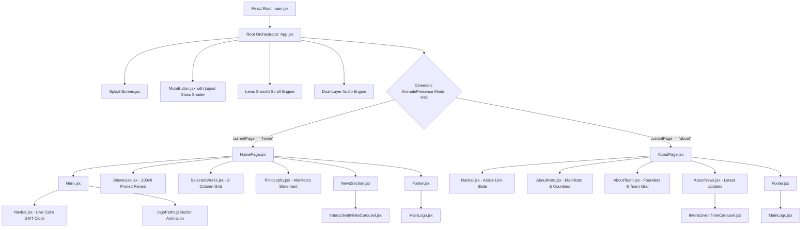
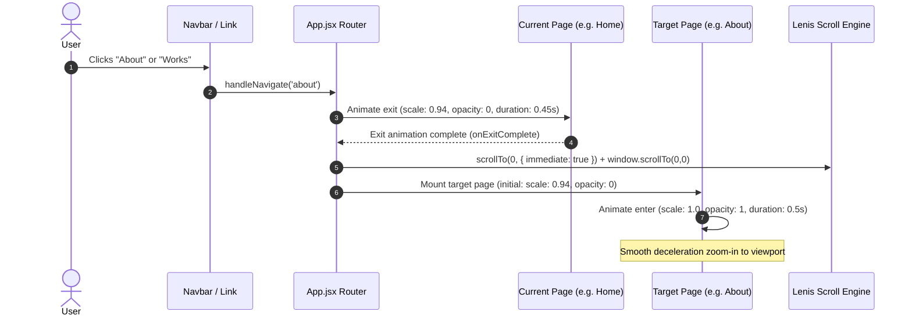
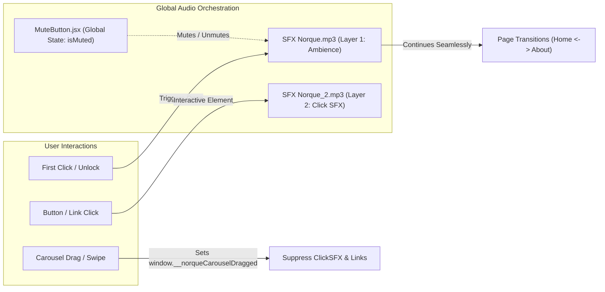

# NORQUE STUDIOS™ — Technical Architecture

This document outlines the software design, component hierarchy, page routing lifecycle, audio engine physics, and infinite carousel buffer geometry of the NORQUE STUDIOS™ website.

---

## 1. System Component Hierarchy



---

## 2. Cinematic Page Transition Lifecycle



---

## 3. Audio Physics & Interaction Architecture



---

## 4. Infinite Carousel Multi-Buffer Geometry

To eliminate visual seams, jumps, or empty cards during continuous auto-play, pointer dragging, or horizontal flick gestures, the carousel utilizes a 5-track layout:

```
[ Track 0: Buffer Left ] [ Track 1: Center Active Track ] [ Track 2: Buffer Right 1 ] [ Track 3: Buffer Right 2 ] [ Track 4: Buffer Right 3 ]
<--------------------------------------------- Total Rendered Width --------------------------------------------->
                                   ▲
                             Viewport Center
```

- **Wrap Interval**: Offset continuously wraps within `[-2 * TrackWidth, -TrackWidth]`.
- **Drag Velocity Calculation**: Instantaneous velocity calculated over normalized 16.6ms frames, transitioning smoothly into friction glide (`velocity *= 0.95^dt`).
- **Drag vs. Click**: If movement exceeds `4px`, the drag flag activates and trailing window click events are intercepted and suppressed in the capture phase.

---

## 5. Viewport Math & Scaling Standard

The Norque design language is pixel-matched to a **1440px desktop grid**:

$$\text{CSS Size (vw)} = \left(\frac{\text{Figma Pixels}}{1440}\right) \times 100$$

| Element | Figma Value | Calculated Value |
| :--- | :--- | :--- |
| Container Margin | `24px` | `1.6667vw` |
| Standard Gap | `12px` | `0.8333vw` |
| Main Section Heading | `46px` | `3.1944vw` |
| Sub-headings | `22px` | `1.5278vw` |
| Body / Captions | `10px` | `0.6944vw` |
| Compact Nav Logo | `73.1px` | `5.0764vw` |
